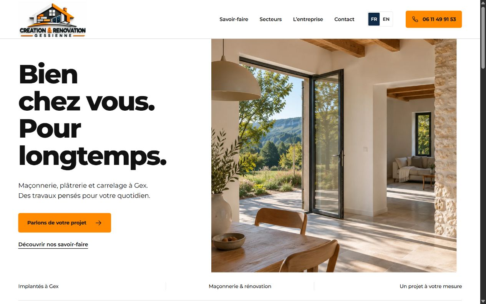

<p align="center"><a href="README.md">Français</a> · <strong>English</strong></p>

# CRG — Création & Rénovation Gessienne

### Spaces made for living. A website built with the same care.

A bilingual website for a **building company based in Gex, France**. Masonry, plasterwork, partitions and tiling: clearly presented services, a considered architectural identity and a straightforward way to prepare the first conversation.



<p align="center"><a href="#quick-start">Run locally</a> · <a href="#the-experience">Explore the features</a> · <a href="#before-public-launch">Prepare for launch</a></p>

## The experience

| For the visitor            | On the website                                                                                        |
| -------------------------- | ----------------------------------------------------------------------------------------------------- |
| Understand the services    | Three dedicated service pages, each with specific information and FAQs.                               |
| Choose a language          | **FR / EN** navigation and an English version of every page under `/en/`.                             |
| Picture the possibilities  | Architectural composition, material and interior imagery, Montserrat and the official brand identity. |
| Prepare a project          | A three-step form: work, project and summary.                                                         |
| Stay in control of contact | A TXT brief, text copying or an SMS to review before sending.                                         |
| Browse across devices      | Responsive layouts, a mobile menu, a skip link and visible keyboard focus.                            |

The project brief works **on the visitor’s device**. Form fields are not sent to a server and no message is sent automatically. Opening an SMS requires a compatible messaging application and device.

## One identity, two languages

**30 static pages: fifteen in French and fifteen in English.** Each language includes the home page, three trades, interior renovation, a service-area hub, three regional pages (Pays de Gex, the French Geneva border area, Geneva and Veyrier), a preparation guide, company information, contact and practical information.

French is the default language. English pages have their own URLs and localized metadata. `hreflang` links and canonical URLs are generated when the public origin is configured. Switching language is an explicit navigation action and does not use a language-preference cookie.

| Element    | Choice                                                                                |
| ---------- | ------------------------------------------------------------------------------------- |
| Identity   | Official logo supplied by the company.                                                |
| Colors     | Orange `#FF8A00`, navy `#0E2A47`, black `#111111`, gray `#F2F2F2` and white.          |
| Typography | Self-hosted Montserrat, distributed with its SIL Open Font License.                   |
| Images     | WebP, lazy loading below the opening section and priority loading for the main image. |
| Motion     | A restrained entrance for the main image and support for `prefers-reduced-motion`.    |

## Quick start

**Requirements: Node.js 22 or later, with npm.** The project has no runtime dependencies and does not require `npm install`.

```bash
git clone https://github.com/joshsegatt/CRG.git
cd CRG
npm run build
npm run dev
```

Open **[http://127.0.0.1:4173/](http://127.0.0.1:4173/)**. The English version is available at **[http://127.0.0.1:4173/en/](http://127.0.0.1:4173/en/)**. Stop the server with `Ctrl+C`.

The server binds to the local `127.0.0.1` interface. View the pages over HTTP: opening a file directly with `file://` does not support the site’s modules and paths.

## Under the hood

| Layer        | Technology                                                             |
| ------------ | ---------------------------------------------------------------------- |
| Pages        | Static HTML generated by a Node.js script.                             |
| Interface    | Native CSS and JavaScript ES modules.                                  |
| Translation  | French content and English translations generated at build time.       |
| Project form | Local validation, a text document and an SMS link.                     |
| Verification | Native `node:test` tests, syntax checks and generated-file validation. |
| Hosting      | Static files in `dist/`; no application server required in production. |

```text
CRG/
├── brand/                  Original brand identity
├── docs/images/            Project previews for documentation
├── src/
│   ├── app.mjs             Menu and project-form interactions
│   ├── brief.mjs           Validation, summary and SMS link
│   ├── styles.css          Identity and responsive layouts
│   └── translations.en.mjs English translations
├── scripts/                Static output checks
├── tests/                  Behavior tests
├── dist/                   Pages and assets served to the browser
├── build.mjs               Website generation
├── server.mjs              Local development server
├── ASSETS.md               Visual asset provenance
└── DESIGN.md               Art direction and visual rules
```

## Edit and verify

Page content and composition are defined in `build.mjs`. Styles and interactions live in `src/`. After editing, regenerate `dist/` and reload the page in the browser.

```bash
npm run lint
npm test
npm run build
npm run check
```

- `lint` checks **JavaScript syntax**; it is not an ESLint analysis.
- `test` runs the project-validation and summary-generation tests.
- `build` generates the pages, shared resources and search-engine files.
- `check` checks generated pages, internal links and resources, alternative text and HTML identifiers.

Follow these commands with desktop and mobile checks: FR / EN navigation, menu, FAQs, form errors, project summary and download. Test SMS behavior on the actual target devices before public launch.

## Before public launch

This version is a presentation and review foundation. Before the official launch:

1. Complete and approve the publication contact, business email and hosting-provider details in the legal information.
2. Set `SITE_URL` to the chosen HTTPS origin and `SITE_INDEXABLE=1`, then run `npm run build` to regenerate metadata, language links and the sitemap.
3. Review robots metadata: previews use `noindex, follow` until indexing is explicitly enabled. `robots.txt` allows crawling so engines can read that instruction. Legal, privacy and visual-credit pages stay out of the index and sitemap.
4. Verify services, contact details and enquiry handling with the company.
5. If email delivery or lead collection is added, implement the actual processing and update the privacy information.

`SITE_URL` accepts an HTTP or HTTPS origin without a path, query parameters or fragment. Without it, the build keeps links suitable for local previews and does not invent a public domain for metadata or the sitemap.

The `dist/` directory can be served by a static host at the root of the chosen domain. The GitHub repository preserves the source; its existence alone does not mean the website is deployed.

## Local search and Google Business Profile

The primary phone is **06 11 49 91 53**. The business is based in Gex and serves France and Switzerland, including Geneva and Veyrier. Regional pages provide relevant preparation advice without inventing local offices.

Titles, descriptions, canonical links, FR/EN alternatives and structured data are generated together. The schema describes one business in Gex and its service areas, with no invented ratings or reviews. The public sitemap includes twenty-four useful URLs.

The French [Google Business Profile kit](docs/GOOGLE-BUSINESS.md) and [SEO launch steps](docs/SEO-LAUNCH.md) contain practical next steps. Search positions are not guaranteed.

## Assets and rights

The architectural visuals are **illustrative synthetic images** created for this website. They do not document projects completed by the company; the visual-credits page makes the same distinction. Provenance and generation prompts are recorded in [ASSETS.md](ASSETS.md).

The logo, name, brand sheet and brand elements belong to the identity of Création & Rénovation Gessienne. Publishing this repository does not grant permission to reuse those elements or establish a general project license. Montserrat includes its [SIL Open Font License](dist/assets/OFL-Montserrat.txt).

---

<p align="center"><strong>Création & Rénovation Gessienne</strong><br>Masonry, plasterwork, partitions and tiling · Gex, France</p>
