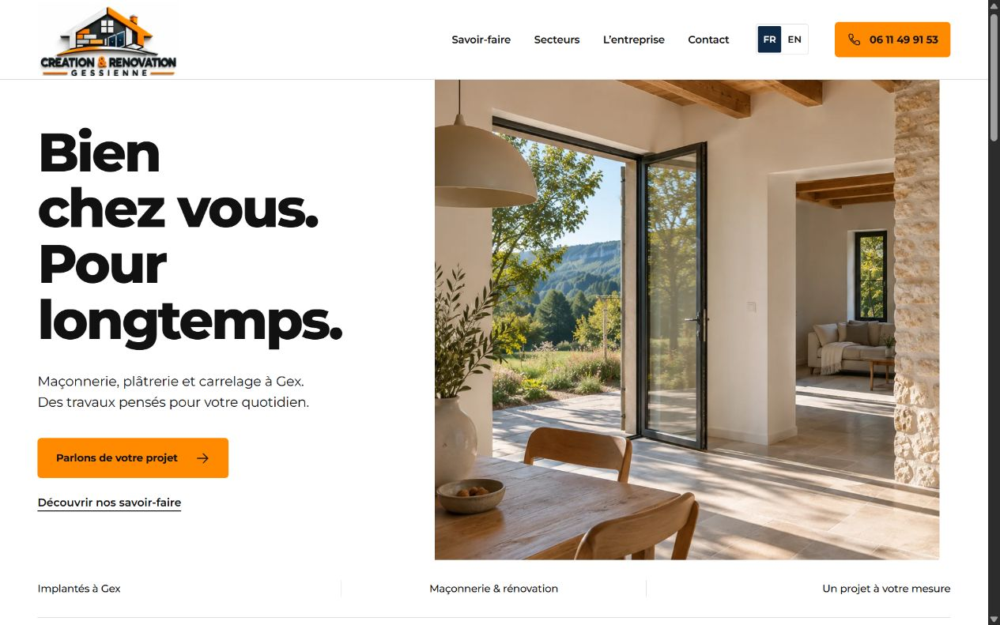

<p align="center"><strong>Français</strong> · <a href="README.en.md">English</a></p>

# CRG — Création & Rénovation Gessienne

### Des espaces à vivre. Une présence en ligne à leur mesure.

Site vitrine bilingue d’une entreprise du bâtiment implantée à **Gex, dans l’Ain**. Maçonnerie, plâtrerie, cloisons et carrelage : une présentation claire des savoir-faire, une identité architecturale soignée et un parcours simple pour préparer un premier échange.



<p align="center"><a href="#démarrage-rapide">Démarrer en local</a> · <a href="#lexpérience">Explorer les fonctionnalités</a> · <a href="#avant-la-mise-en-ligne-publique">Préparer la publication</a></p>

## L’expérience

| Pour le visiteur              | Dans le site                                                                                   |
| ----------------------------- | ---------------------------------------------------------------------------------------------- |
| Comprendre les prestations    | Trois pages métier dédiées, avec contenus et questions fréquentes spécifiques.                 |
| Choisir sa langue             | Navigation **FR / EN** et version anglaise de chaque page, à partir de `/en/`.                 |
| Se projeter                   | Composition architecturale, visuels de matières et volumes, Montserrat et identité officielle. |
| Préparer son projet           | Formulaire en trois étapes : travaux, projet, résumé.                                          |
| Garder la main sur le contact | Résumé TXT, copie du texte ou ouverture d’un SMS à vérifier avant l’envoi.                     |
| Naviguer sur tous les écrans  | Mise en page responsive, menu mobile, lien d’évitement et focus clavier visible.               |

Le parcours de contact fonctionne **sur l’appareil du visiteur**. Les champs ne sont pas transmis à un serveur et aucun message n’est envoyé automatiquement. L’ouverture d’un SMS dépend d’une application compatible et de l’appareil utilisé.

## Une identité, deux langues

**30 pages statiques : quinze en français, quinze en anglais.** Chaque version réunit l’accueil, les trois métiers, la rénovation intérieure, les secteurs d’intervention, trois pages régionales (Pays de Gex, Genevois français, Genève et Veyrier), un guide de préparation, l’entreprise, le contact et les informations pratiques.

Le français est la langue par défaut. Les pages anglaises disposent de leur propre URL et de métadonnées adaptées. Les liens `hreflang` et les URL canoniques sont produits lorsque l’origine publique est configurée. Le changement de langue est une navigation explicite, sans cookie de préférence linguistique.

| Élément     | Choix                                                                                     |
| ----------- | ----------------------------------------------------------------------------------------- |
| Identité    | Logo officiel fourni par l’entreprise.                                                    |
| Couleurs    | Orange `#FF8A00`, bleu `#0E2A47`, noir `#111111`, gris `#F2F2F2`, blanc.                  |
| Typographie | Montserrat, servie localement avec sa licence SIL Open Font License.                      |
| Images      | WebP, chargement différé sous la première section et priorité donnée au visuel principal. |
| Mouvement   | Entrée discrète du visuel principal et respect de `prefers-reduced-motion`.               |

## Démarrage rapide

**Prérequis : Node.js 22 ou supérieur, avec npm.** Le projet n’a aucune dépendance d’exécution et ne nécessite pas `npm install`.

```bash
git clone https://github.com/joshsegatt/CRG.git
cd CRG
npm run build
npm run dev
```

Ouvrir **[http://127.0.0.1:4173/](http://127.0.0.1:4173/)**. La version anglaise est accessible à **[http://127.0.0.1:4173/en/](http://127.0.0.1:4173/en/)**. Arrêter le serveur avec `Ctrl+C`.

Le serveur est lié à l’interface locale `127.0.0.1`. Consulter les pages par HTTP : l’ouverture directe d’un fichier avec `file://` ne prend pas en charge les modules et les chemins du site.

## Sous le capot

| Couche       | Technologie                                                                         |
| ------------ | ----------------------------------------------------------------------------------- |
| Pages        | HTML statique généré par un script Node.js.                                         |
| Interface    | CSS natif et JavaScript en modules ES.                                              |
| Traduction   | Contenu français et traductions anglaises générés à la compilation.                 |
| Formulaire   | Validation locale, document texte et lien SMS.                                      |
| Vérification | Tests natifs `node:test`, contrôle de syntaxe et vérification des fichiers générés. |
| Hébergement  | Contenu statique dans `dist/`, sans serveur applicatif nécessaire en production.    |

```text
CRG/
├── brand/                  Identité visuelle originale
├── docs/images/            Aperçus pour la documentation
├── src/
│   ├── app.mjs             Menu et interactions du formulaire
│   ├── brief.mjs           Validation, résumé et lien SMS
│   ├── styles.css          Identité et mise en page responsive
│   └── translations.en.mjs Traductions anglaises
├── scripts/                Contrôles de la sortie statique
├── tests/                  Tests de comportement
├── dist/                   Pages et ressources du site
├── build.mjs               Génération du site
├── server.mjs              Serveur de développement local
├── ASSETS.md               Provenance des ressources visuelles
└── DESIGN.md               Direction artistique et règles visuelles
```

## Modifier et vérifier

Le contenu et l’assemblage des pages sont définis dans `build.mjs`. Les styles et interactions sont regroupés dans `src/`. Après modification, régénérer `dist/` et recharger la page dans le navigateur.

```bash
npm run lint
npm test
npm run build
npm run check
```

- `lint` vérifie la **syntaxe JavaScript** ; il ne remplace pas une analyse ESLint.
- `test` vérifie le formulaire, le SMS, la localisation, les animations réduites et un build public isolé des trente pages.
- `build` génère les pages, les ressources communes et les fichiers destinés aux moteurs de recherche.
- `check` contrôle les pages générées, les liens et ressources internes, les textes alternatifs et les identifiants HTML.

Compléter ces commandes par une vérification sur ordinateur et mobile : navigation FR / EN, menu, FAQ, erreurs du formulaire, résumé et téléchargement. Tester les SMS sur les appareils réellement utilisés avant le lancement public.

## Avant la mise en ligne publique

Cette version constitue une base de présentation et de validation. Avant le lancement officiel :

1. Compléter et valider le responsable de publication, l’e-mail professionnel et les coordonnées de l’hébergeur dans les informations légales.
2. Définir `SITE_URL` avec l’origine HTTPS du domaine retenu et `SITE_INDEXABLE=1`, puis lancer `npm run build` pour régénérer les métadonnées, les liens de langue et le sitemap.
3. Contrôler les balises robots : sans activation explicite, les pages restent en `noindex, follow`. `robots.txt` autorise leur lecture pour que les moteurs voient cette consigne. Les pages légales, de confidentialité et de crédits restent hors index et hors sitemap.
4. Vérifier les prestations, les coordonnées et l’organisation des demandes avec l’entreprise.
5. Si un envoi par e-mail ou une collecte de contacts est ajouté, implémenter son traitement réel et actualiser l’information de confidentialité.

`SITE_URL` accepte une origine HTTP ou HTTPS, sans chemin, paramètres ni fragment. Sans cette variable, la compilation conserve des liens adaptés à la prévisualisation locale, sans inventer de domaine public pour les métadonnées et le sitemap.

Le dossier `dist/` peut être servi par un hébergement statique à la racine du domaine retenu. Le dépôt GitHub conserve les sources ; il ne signifie pas, à lui seul, que le site est déployé.

## Référencement local et fiche Google

Le téléphone principal est **06 11 49 91 53**. L’entreprise est implantée à Gex et intervient en France et en Suisse, notamment à Genève et Veyrier. Les pages régionales apportent des informations de préparation propres aux secteurs, sans créer d’agences fictives.

Les titres, descriptions, liens canoniques, alternances FR/EN et données structurées sont générés ensemble. Le schéma décrit une seule entreprise à Gex et ses zones desservies ; il ne contient ni notes ni avis inventés. Le sitemap public contient vingt-quatre URL utiles.

Consulter le [kit de la fiche Google](docs/GOOGLE-BUSINESS.md) et les [étapes du lancement SEO](docs/SEO-LAUNCH.md). Le classement Google dépend également de la distance, de la pertinence et de la notoriété : aucune position n’est garantie.

## Ressources et droits

Les visuels architecturaux sont des **images de synthèse illustratives** créées pour le site. Ils ne documentent pas des chantiers réalisés par l’entreprise ; cette distinction figure aussi sur la page de crédits. Leur provenance et les prompts sont conservés dans [ASSETS.md](ASSETS.md).

Le logo, le nom, la planche d’identité et les éléments de marque sont propres à Création & Rénovation Gessienne. La présence de ce dépôt ne concède pas de droit de réutilisation de ces éléments ni de licence générale sur le projet. Montserrat est accompagnée de sa [licence SIL Open Font License](dist/assets/OFL-Montserrat.txt).

---

<p align="center"><strong>Création & Rénovation Gessienne</strong><br>Maçonnerie, plâtrerie, cloisons et carrelage · Gex, France</p>
